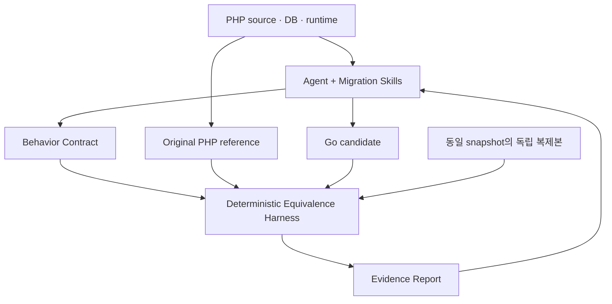

# php2go

PHP 애플리케이션을 Go로 옮기기 위한 기능 동등성 중심의 Agent Skills 모음입니다. 원본 PHP를 Reference Oracle로 실행하고, 동일한 입력과 초기 상태에서 Go의 관찰 가능한 동작을 비교하는 것을 목표로 합니다.

Skills는 분석·계약 추출·구현·수정 방법을 정의합니다. 동등성 판정은 실행 가능한 검증 도구가 담당합니다. AI의 코드 리뷰나 HTTP 200 응답만으로 동등성을 판정하지 않습니다.

## 현재 범위

현재 제공하는 것은 7개 Skill과 계약·증거·SQL 계층 형식의 설계 문서입니다. `equiv` CLI, 자동 수집기, SQL 자동 추출기, 대상 애플리케이션의 sqlc 설정·생성 코드, DB/세션 어댑터, 기계 검증용 JSON Schema는 아직 구현하지 않았습니다. 이 저장소만으로 마이그레이션이나 동등성 검사가 자동 실행되지는 않습니다.

범용 PHP → Go 컴파일러, 자체 IR, PHP 전체 호환 런타임은 초기 범위에 포함하지 않습니다. 분석 도구와 변환 도구는 대상 프로젝트에 맞게 선택하고, 필요하면 PHP-Parser나 Rector 같은 기존 도구의 도입을 검토합니다.

## 구조와 역할



| Skill | 책임 | 주요 산출물 |
| --- | --- | --- |
| [php-analyze](skills/php-analyze/SKILL.md) | 의존성, 진입점, 상태와 기능 경계 분석 | Analysis Report / Feature Inventory |
| [sql-extract](skills/sql-extract/SKILL.md) | SQL·스키마 추출, 바인딩, 정적 쿼리 분리와 sqlc 생성 검증 | SQL Inventory / schema.sql / queries / sqlc 설정 |
| [behavior-extract](skills/behavior-extract/SKILL.md) | 관찰 가능한 계약과 시나리오 정의 | Behavior Contract |
| [fixture-capture](skills/fixture-capture/SKILL.md) | 원본 실행과 초기 상태의 재현 자료 수집 | Fixtures / Capture Manifest |
| [go-migrate](skills/go-migrate/SKILL.md) | 계약을 충족하는 Go 구현과 수정 | Go source / Migration Notes |
| [equivalence-check](skills/equivalence-check/SKILL.md) | 실행 도구로 입력·출력·부작용 비교 | Diff / Evidence Report |
| [security-review](skills/security-review/SKILL.md) | 원본 취약점과 새 취약점, 승인된 변경 추적 | Security Report / Change Records |

```text
php2go/
├── README.md
└── skills/
    ├── php-analyze/SKILL.md
    ├── sql-extract/
    │   ├── SKILL.md
    │   └── references/sqlc-policy.md
    ├── behavior-extract/
    │   ├── SKILL.md
    │   └── references/behavior-contract.md
    ├── fixture-capture/SKILL.md
    ├── go-migrate/SKILL.md
    ├── equivalence-check/
    │   ├── SKILL.md
    │   └── references/evidence-protocol.md
    └── security-review/SKILL.md
```

향후 `cmd/equiv/`에 검증 CLI를, `contracts/schema/`에 계약·fixture·증거의 기계 검증 스키마를 구현합니다. 현재 참조 문서는 구현할 인터페이스의 초안이며 실행 가능한 스키마가 아닙니다.

## 사용 방법

Skill을 지원하는 Agent에서 필요한 Skill 폴더를 해당 Agent의 skill 검색 경로에 복사하거나 연결합니다. 각 폴더의 `references/`도 함께 배포합니다. Skill은 다른 Skill의 설치를 전제하지 않으며, 전체 흐름을 실행하려면 7개를 함께 제공합니다. 자동 발견과 설치 경로는 사용하는 Agent의 설정을 따릅니다.

예시 요청:

```text
Migrate this PHP application to Go.
Preserve observable behavior.
Use the functional-equivalence skills.
```

Agent는 실행 도구·런타임·접근 가능한 테스트 환경부터 확인하고 다음 흐름으로 작업합니다.

1. 원본 revision, PHP 실행 환경, 의존성, 기능 목록과 상태 경계를 기록합니다.
2. 기능별 계약과 정상·경계·권한·실패 시나리오를 추출합니다.
3. 원본을 격리 실행해 재현 가능한 fixture와 원시 관찰값을 수집합니다.
4. 원본 스키마와 SQL을 추출해 sqlc로 DB 접근 코드를 생성하고, 계약과 fixture를 기준으로 Go 코드를 구현합니다.
5. 동일 snapshot에서 만든 독립 상태로 PHP와 Go를 실행해 비교합니다.
6. 차이를 수정하고 영향받는 시나리오를 다시 실행합니다. 미검증·미지원 범위도 보고합니다.

검증 도구가 없으면 실행 증거를 만들었다고 주장하지 않습니다. 수집되지 않은 시나리오는 `NOT COVERED`, 실행 또는 관찰을 지원하지 못하는 범위는 `UNSUPPORTED`로 남깁니다. 이 단계에서 Skill 자체가 CLI 판정을 대신하지 않습니다.

## DB 계층: SQL-first + sqlc

후보 애플리케이션의 DB 접근은 `.sql` 파일을 기준으로 정의하고 sqlc 생성 메서드를 사용합니다. PHP의 embedded SQL을 `db/schema.sql`과 `db/queries/*.sql`로 추출하고, `sqlc.yaml`과 도구 버전을 고정해 `internal/dbgen/`에 Go 코드를 생성합니다. 이 경로는 마이그레이션 대상 프로젝트의 권장 구조이며 현재 저장소에 생성된 코드는 없습니다.

```text
PHP SQL + 실제 DB 스키마
  → SQL Inventory + schema.sql + queries/*.sql
  → sqlc generate
  → typed query methods
  → Go business logic
```

sqlc의 [MySQL 안내](https://docs.sqlc.dev/en/latest/tutorials/getting-started-mysql.html)는 스키마와 쿼리에서 Go 코드를 생성하는 흐름을 제공합니다. 생성 성공은 타입·쿼리 생성 단계의 확인이며 원본 동작과의 동등성을 보장하지 않습니다.

애플리케이션에서 SQL 문자열을 조립하거나 `Query*`/`Exec*`/`Prepare*`를 직접 호출하지 않습니다. 연결 생성, pool, health check와 transaction begin/commit/rollback은 인프라 코드가 담당합니다. transaction 내부 쿼리는 생성된 `WithTx` 메서드로 연결합니다. sqlc 자체는 DB 스키마 마이그레이션 실행기가 아니므로 DDL 적용과 fixture 복원·관찰은 별도 도구가 담당합니다. 이 도구의 SQL 실행은 애플리케이션 DB 접근 경계와 구분합니다. [트랜잭션 문서](https://docs.sqlc.dev/en/latest/howto/transactions.html), [생성·스키마 적용 문서](https://docs.sqlc.dev/en/latest/howto/generate.html)를 참고하세요.

모든 원본 SQL과 구성 분기는 추적하되 sqlc가 처리할 수 없는 구문을 생략하거나 raw SQL로 우회하지 않습니다. 동적 조건·정렬은 유한한 정적 쿼리로 나누고 값만 바인딩합니다. 그누보드의 게시판별 테이블처럼 식별자가 동적이면 배포 시 테이블 목록을 고정해 정적 쿼리를 생성하고 허용 목록으로 dispatch합니다. 런타임에 임의 테이블을 추가해야 한다면 재생성·재배포 제약을 명시하고, 지원하지 못하는 동작은 `UNSUPPORTED`로 남깁니다. 테이블 통합 같은 데이터 모델 변경은 별도 설계와 검증이 필요합니다.

파라미터화와 입력 검증은 구분합니다. `ParseInt` 실패 시 400을 반환하거나 `LIMIT 1`을 추가하는 것은 원본과 다를 수 있으므로 자동 적용하지 않습니다. SQL injection 방지는 보안 변경으로 추적하되 정상 입력의 타입 변환·에러·응답·DB 효과도 재검증합니다.

구체적인 추출 규칙, MySQL 설정 예시와 완료 조건은 [SQL/sqlc 정책](skills/sql-extract/references/sqlc-policy.md)에 정의합니다.

## 동등성의 기준

비교 대상은 HTTP status, headers, body뿐 아니라 DB의 쓰기/삭제, 쿠키·세션 변화, 파일 생성/수정/삭제, 메일·큐·외부 API 등 외부 효과입니다. 요청 순서와 로그인 상태가 이어지는 다단계 시나리오도 포함합니다.

각 시나리오는 같은 초기 DB·파일·세션·설정에서 시작합니다. PHP 실행 후 변경된 DB를 Go에 재사용하지 않습니다. 다단계 시나리오 내부에서는 각 구현의 상태를 유지하고, 시나리오 사이에서는 상태를 초기화합니다. 외부 효과는 로컬 대역에서 기록하며 실제 메일 발송이나 운영 데이터 변경을 fixture 수집에 사용하지 않습니다.

시간·랜덤·자동 증가 ID는 먼저 실행 환경에서 제어합니다. 제어가 불가능하면 필드별 비교 규칙과 이유, 보존해야 할 관계를 계약에 명시합니다. HTML 공백, 배열 순서, ID, timestamp를 일괄 삭제하는 정규화는 허용하지 않습니다. DB 최종 상태뿐 아니라 계약에 중요한 트랜잭션·중간 효과도 관찰해야 합니다.

계약은 원본 동작에서 추출한 검토 가능한 기준입니다. Go에 맞춰 계약이나 fixture를 바꿔 통과시키지 않습니다. 변경이 필요하면 근거와 변경 이력을 남기고 원본을 다시 수집합니다. 계약과 원본 실행이 충돌하면 이를 드러내고 기준을 확인한 후 재검증합니다.

세부 형식은 [Behavior Contract](skills/behavior-extract/references/behavior-contract.md)와 [Evidence Protocol](skills/equivalence-check/references/evidence-protocol.md)에 정의합니다.

## 결과와 보장 수준

| 상태 | 의미 |
| --- | --- |
| `PASS` | 선언한 관찰 범위를 빠짐없이 수집·비교한 시나리오에서 동등 |
| `MISMATCH` | 원본과 후보 사이의 재현 가능한 동작 차이를 발견 |
| `NOT COVERED` | 필요한 시나리오나 유효한 실행 증거가 부족 |
| `UNSUPPORTED` | 현재 도구가 해당 기능을 실행·관찰·비교할 수 없음 |

상태는 기능·시나리오·관찰 항목 수준으로 기록합니다. 일부 항목의 PASS로 전체 기능을 PASS 처리하지 않습니다. 실행 오류와 불안정한 fixture를 후보의 동작 차이로 오인하지 않으며, 유효한 비교가 성립하지 않으면 원인을 함께 남깁니다.

보고서는 기능 목록 전체를 분모로 삼고, 계약·시나리오·관찰 항목의 커버리지와 알려진 불확실성을 보여줍니다. 소스 코드의 줄 커버리지와 기능 동등성의 커버리지는 별개입니다. 검증한 입력을 모두 통과해도 관찰하지 않은 입력의 동등성까지 증명하지는 않습니다.

보안상 위험한 원본 동작을 의도적으로 수정할 수 있습니다. 이때 실제 비교 결과는 `MISMATCH`로 보존하고, 승인자·근거·범위·회귀 시나리오를 가진 보안 변경 기록을 별도로 연결합니다. 승인된 차이가 있는 결과를 완전 동등 PASS로 표현하지 않습니다. 보안 검토만으로 원본 취약점의 재현을 허가하거나 수정 승인을 얻었다고 간주하지 않습니다.

## 구현 순서

첫 CLI 범위는 작은 PHP/Go 예제의 읽기 요청과 명시적인 status/header/body 비교로 시작합니다. 이어서 초기화가 검증된 DB 쓰기, 다단계 세션, 파일·외부 효과 어댑터를 추가합니다. 각 단계는 지원하는 관찰 범위와 미지원 항목을 보고해야 합니다.

CLI는 버전이 고정된 계약·fixture·실행 설정을 입력받아 원시 관찰값, 구조화 diff, 기계 판독 가능한 결과를 출력해야 합니다. 구체적인 명령 구문과 종료 코드는 구현 시 확정하며, 이 README에는 아직 실행할 수 없는 명령을 제공하지 않습니다.

MIT License. [LICENSE](LICENSE)를 참고하세요.
