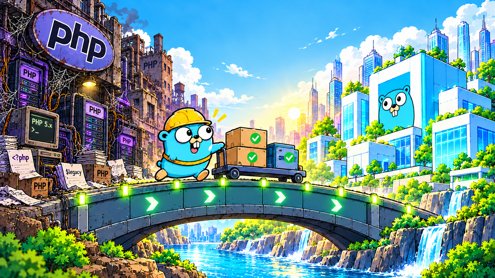

# php2go

**Migrate PHP to Go with AI, without breaking existing behavior.**

php2go는 오래된 PHP 서비스를 Go로 마이그레이션하기 위한 **Agent Skills 프로젝트**입니다.

AI로 코드 변환을 가속하면서도, 기존 PHP와 Go를 같은 조건에서 실행해 실제 동작이 일치하는지 검증하는 것을 목표로 합니다.

## Why Go?

PHP는 오랫동안 웹 서비스를 지탱해 왔지만, 레거시 시스템에서는 오래된 런타임, 확장 모듈, 복잡한 배포 환경이 유지보수 부담으로 이어지곤 합니다. 최근 발견된 PHP 런타임 보안 취약점 역시 지속적인 업데이트와 운영 관리의 중요성을 보여줍니다.

Go는 이러한 서비스를 더 단순한 구조로 옮기기에 좋은 선택입니다.

- **Simple deployment** — 별도 PHP 런타임 없이 컴파일된 실행 파일을 배포할 수 있습니다.
- **Maintainable code** — 정적 타입, 명시적인 오류 처리, 단순한 패키지 구조로 코드를 정리할 수 있습니다.
- **Built for servers** — HTTP, SQL, 동시성 처리와 테스트 도구를 기본적으로 제공합니다.
- **SQL-first** — 기존 SQL을 보존하고 타입 안전한 데이터 접근 계층을 구성할 수 있습니다.

물론 Go로 옮긴다고 모든 보안 문제가 자동으로 해결되는 것은 아닙니다. 중요한 것은 **이해하고 검증할 수 있는 코드로 전환하는 것**입니다.

## How it works

AI가 PHP 코드를 Go로 번역하는 것만으로는 충분하지 않습니다. HTTP 응답이 같더라도 DB 변경, 세션, 파일 생성 등의 동작이 달라질 수 있기 때문입니다.

php2go는 다음 과정을 지향합니다.

1. **Analyze** — 기존 PHP의 동작과 의존성을 분석합니다.
2. **Contract** — 기능별 Behavior Contract와 재현 가능한 입력을 만듭니다.
3. **Migrate** — 기존 URL, SQL, DB 구조를 최대한 유지하며 Go로 구현합니다.
4. **Verify** — PHP와 Go를 실행해 응답과 부작용을 비교합니다.

이 저장소는 **Skills-first**로 시작합니다. Agent가 대상 프로젝트의 기존 도구를 활용하고, 필요한 Go 코드·프록시 설정·테스트 및 비교 스크립트를 그 프로젝트에 작성합니다. 동등성은 실제 실행 결과와 명시적인 비교 규칙으로 판정하며, 별도의 전용 CLI를 설치해야만 작업할 수 있는 구조는 아닙니다.

원본의 보안상 위험한 동작을 수정해야 한다면, 해당 차이를 의도적인 변경으로 별도 기록합니다.

## Virtual patch로 점진적으로 전환하기

전체 PHP를 Go로 바꾸는 동안에도, Go 리버스 프록시를 앞에 두어 분석에서 확인한 일부 보안 위험을 임시로 완화할 수 있습니다. 범용 WAF를 새로 만드는 대신, 레거시 PHP의 코드와 기능 계약·보안 분석을 근거로 해당 기능에 필요한 방어 규칙을 만듭니다.

`virtual-patch`는 확인된 위험에 임시 완화가 필요할 때만 선택합니다. 일반 HTTP 전달·경로 차단·Go 전환부터 시작하되, **대상 서비스의 모든 기능을 보존하는 것**이 목표입니다. WebSocket·SSE·세션 연동 등이 필요하면 기존 구성 요소를 활용하거나 필요한 지원을 구현하고 검증합니다. 초기 구현 순서 때문에 기능을 제외하지 않으며, 검증 전에는 기존 PHP 경로를 유지하고 준비가 끝난 기능부터 전환합니다.

1. **분석** — PHP 기능의 위험한 입력 경로와 동작을 확인합니다.
2. **임시 방어** — 분석에 근거한 방어를 적용하고 의도한 제한과 정상 동작을 검증합니다. 기능에 필요한 프로토콜을 보존하며 나머지 요청은 기존 PHP로 전달합니다.
3. **기능 교체** — 방어된 PHP를 운영하는 동안 해당 기능을 Go로 구현하고, 동등성과 영구적인 보안 수정을 검증한 뒤 경로를 전환합니다.
4. **함께 제거** — Go가 임시 규칙 없이도 필요한 보호를 제공하는지 확인한 후, 규칙과 더 이상 사용하지 않는 해당 PHP 코드·경로·의존성을 함께 제거합니다.

이 과정을 기능마다 반복합니다. 다른 PHP 기능이나 롤백에 필요한 공유 의존성은 유지하고, 모든 사용처가 사라진 뒤 PHP 런타임과 upstream을 제거합니다. 임시 방어의 한계·만료·롤백 조건을 기록하며, 단순히 프록시를 통과한 PHP 기능을 Go로 전환했다고 집계하지 않습니다.

## Current status

현재 PHP 분석, 계약 추출, fixture 수집, SQL 추출, Go 구현, 동등성 검증, 보안 검토를 위한 7개 기본 Skill과 [virtual-patch Skill](skills/virtual-patch/SKILL.md), PHP와 Go의 동작 차이를 PHP 5.x–8.x 버전별로 정리한 [php-edge-cases Skill](skills/php-edge-cases/SKILL.md), 총 **9개 Agent Skill**을 제공합니다. php-edge-cases에는 대상 PHP 런타임에서 직접 실행해 확인하는 probe 스크립트가 포함되어 있습니다.

별도의 검증 CLI나 공통 프록시 제품은 필수 구성 요소가 아닙니다. 실제 마이그레이션에서 반복되는 코드가 확인되면 필요한 부분만 공통 도구로 추출합니다. 배포용 Skill 패키징 스크립트는 제공하며, 대상 애플리케이션의 구현과 검증은 Agent가 수행합니다.

자세한 작업 지침은 [AGENTS.md](AGENTS.md)와 [skills/](skills/)에서 확인할 수 있습니다.

[MIT License](LICENSE)
